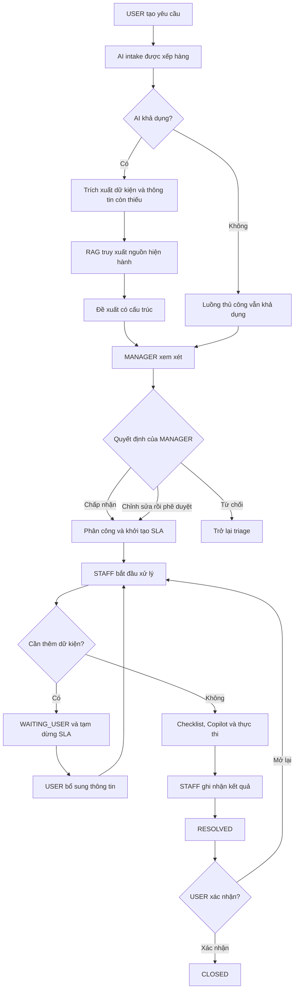
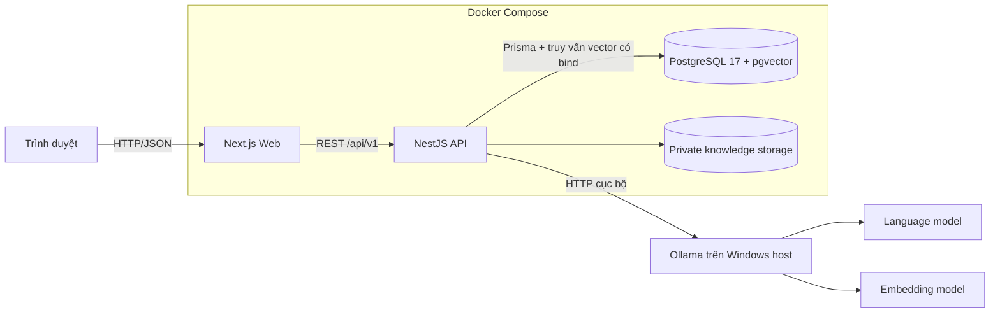

# MobiFlow AI

> Nền tảng điều phối yêu cầu vận hành nội bộ bằng AI cục bộ, biến mô tả tự nhiên thành quy trình có cấu trúc, có bằng chứng, có phân quyền và luôn giữ con người ở vị trí quyết định cuối cùng.

MobiFlow AI được xây dựng cho các tình huống vận hành doanh nghiệp mà một yêu cầu ban đầu thường rất ngắn, thiếu dữ kiện và phải đi qua nhiều bước phối hợp: tiếp nhận, phân loại, tra cứu quy trình, đề xuất người xử lý, phê duyệt, thực thi, theo dõi SLA, tổng kết và xác nhận kết quả.

Hệ thống không phải là một chatbot đứng riêng và cũng không cho AI tự động ra quyết định nghiệp vụ. AI chỉ phân tích, truy xuất bằng chứng và đưa ra đề xuất trong một phạm vi được kiểm soát. Mọi hành động quan trọng như phê duyệt, phân công, đổi mức ưu tiên, hoàn tất hay đóng yêu cầu đều do người có thẩm quyền thực hiện và được lưu vết.

---

## Mục lục

- [Tổng quan](#tổng-quan)
- [Vấn đề MobiFlow AI giải quyết](#vấn-đề-mobiflow-ai-giải-quyết)
- [Điểm khác biệt cốt lõi](#điểm-khác-biệt-cốt-lõi)
- [Vai trò và quyền hạn](#vai-trò-và-quyền-hạn)
- [Luồng nghiệp vụ hoàn chỉnh](#luồng-nghiệp-vụ-hoàn-chỉnh)
- [Trạng thái của một yêu cầu](#trạng-thái-của-một-yêu-cầu)
- [Các nhóm tính năng](#các-nhóm-tính-năng)
- [AI, RAG và Copilot hoạt động như thế nào](#ai-rag-và-copilot-hoạt-động-như-thế-nào)
- [Kiểm soát của con người và an toàn AI](#kiểm-soát-của-con-người-và-an-toàn-ai)
- [SLA và đo lường vận hành](#sla-và-đo-lường-vận-hành)
- [Giao diện và trải nghiệm người dùng](#giao-diện-và-trải-nghiệm-người-dùng)
- [Kiến trúc hệ thống](#kiến-trúc-hệ-thống)
- [Công nghệ sử dụng](#công-nghệ-sử-dụng)
- [Cấu trúc repository](#cấu-trúc-repository)
- [Yêu cầu hệ thống](#yêu-cầu-hệ-thống)
- [Khởi chạy nhanh](#khởi-chạy-nhanh)
- [Tài khoản demo](#tài-khoản-demo)
- [Kịch bản demo đề xuất](#kịch-bản-demo-đề-xuất)
- [Các chế độ chạy](#các-chế-độ-chạy)
- [Cấu hình môi trường](#cấu-hình-môi-trường)
- [Health check và trạng thái suy giảm](#health-check-và-trạng-thái-suy-giảm)
- [Kiểm thử và đánh giá](#kiểm-thử-và-đánh-giá)
- [Kết quả kiểm chứng hiện có](#kết-quả-kiểm-chứng-hiện-có)
- [Bảo mật và toàn vẹn dữ liệu](#bảo-mật-và-toàn-vẹn-dữ-liệu)
- [Xử lý sự cố thường gặp](#xử-lý-sự-cố-thường-gặp)
- [Giới hạn và những gì V1 không làm](#giới-hạn-và-những-gì-v1-không-làm)
- [Tài liệu tham khảo](#tài-liệu-tham-khảo)
- [Trạng thái phát hành](#trạng-thái-phát-hành)

---

## Tổng quan

MobiFlow AI tổ chức toàn bộ vòng đời của một yêu cầu vận hành theo chuỗi kiểm soát sau:

```text
Yêu cầu bằng ngôn ngữ tự nhiên
        ↓
AI trích xuất dữ kiện và nhận diện thông tin còn thiếu
        ↓
RAG truy xuất quy trình, chính sách và bằng chứng nội bộ
        ↓
Các công cụ chỉ-đọc thu thập SLA, lịch sử, tải công việc và ứng viên phù hợp
        ↓
AI tạo đề xuất có cấu trúc và trích dẫn nguồn
        ↓
MANAGER chấp nhận, chỉnh sửa hoặc từ chối
        ↓
STAFF thực thi với checklist, Copilot và cảnh báo SLA
        ↓
AI hỗ trợ tóm tắt kết quả; USER xác nhận hoặc mở lại yêu cầu
        ↓
Hệ thống ghi nhận lịch sử, audit và dữ liệu đo lường
```

Phiên bản V1 đã hoàn thành chuỗi milestone M0–M10, bao gồm nền tảng kỹ thuật, xác thực và phân quyền, quy trình thủ công, phân tích AI cục bộ, kho tri thức RAG, công cụ AI giới hạn, phê duyệt của quản lý, Staff Copilot, SLA, analytics, bộ đánh giá và quy trình phát hành.

Nhánh phát triển hiện tại bổ sung đợt làm mới giao diện V1.1 ở phía frontend. Đợt này không thay đổi quy tắc nghiệp vụ, hợp đồng API, schema cơ sở dữ liệu hay ranh giới quyền hạn đã đóng băng của V1.

## Vấn đề MobiFlow AI giải quyết

Trong vận hành nội bộ, một yêu cầu thực tế thường gặp các vấn đề sau:

- Người gửi mô tả sự cố bằng ngôn ngữ tự nhiên và thiếu trường dữ liệu bắt buộc.
- Người điều phối phải tự tìm SOP, SLA, đội phụ trách và các ca tương tự.
- Việc phân công dễ phụ thuộc vào kinh nghiệm cá nhân hoặc thông tin không còn mới.
- Nhiều quyết định quan trọng không có bằng chứng hoặc không lưu được lý do.
- Nhân viên xử lý phải chuyển qua nhiều nguồn để hiểu bối cảnh và kiểm tra các bước.
- Thời gian chờ người dùng bổ sung thông tin dễ bị tính sai vào SLA.
- Báo cáo cuối kỳ thường thiếu dữ liệu gốc để truy vết.

MobiFlow AI gom các bước này vào một hệ thống thống nhất. AI giúp giảm thời gian đọc và tra cứu, còn workflow, phân quyền, state machine và audit bảo đảm rằng tốc độ không đánh đổi quyền kiểm soát.

## Điểm khác biệt cốt lõi

### Local-first

Ngôn ngữ và embedding được xử lý bởi Ollama chạy trên máy Windows của người vận hành. PostgreSQL, API và web chạy cục bộ; trình duyệt không kết nối trực tiếp tới Ollama hay cơ sở dữ liệu.

### AI có bằng chứng

Khi RAG được bật, kết quả AI chỉ được công bố cùng các nguồn hiện hành đã được kiểm tra. ID nguồn, phiên bản tài liệu, đoạn trích và quyền truy cập đều được backend xác thực lại.

### Human-in-the-loop bắt buộc

AI có thể đề xuất nhưng không thể phê duyệt, phân công, đổi mức ưu tiên, đóng yêu cầu hay thay đổi vai trò. MANAGER phải đưa ra quyết định nghiệp vụ rõ ràng.

### Quy trình vẫn hoạt động khi AI ngoại tuyến

USER, STAFF và MANAGER vẫn hoàn thành được toàn bộ luồng thủ công nếu Ollama, model ngôn ngữ, model embedding hoặc chỉ mục RAG không sẵn sàng.

### Dữ liệu nhất quán và chống ghi đè

Mọi mutation của yêu cầu đều mang `expectedVersion`. Nếu dữ liệu đã thay đổi, thao tác cũ bị từ chối và không được phép tạo ra cập nhật một phần.

### Đo lường trung thực

Kết quả evaluation được lưu cùng danh tính model, môi trường, thời gian và từng trường hợp kiểm thử. Các lần chạy thất bại vẫn được giữ lại; hệ thống không thay số đo thực bằng fixture để tạo kết quả đẹp.

## Vai trò và quyền hạn

V1 có đúng ba vai trò đăng nhập: `USER`, `STAFF` và `MANAGER`.

> [!IMPORTANT]
> `MANAGER` là **quản lý vận hành nghiệp vụ**, không phải `ADMIN` quản trị hệ thống. V1 không có vai trò đăng nhập `ADMIN`. `AI` và `SYSTEM` chỉ là loại actor nội bộ phục vụ audit, không phải tài khoản đăng nhập.

| Vai trò | Mục tiêu | Quyền chính | Giới hạn chính |
| --- | --- | --- | --- |
| `USER` | Gửi và theo dõi yêu cầu của mình | Tạo yêu cầu, xem yêu cầu sở hữu, trao đổi, bổ sung dữ kiện, xác nhận đóng, mở lại, gửi phản hồi, hủy khi đủ điều kiện | Không xem yêu cầu của người khác; không phân công hay phê duyệt |
| `STAFF` | Xử lý yêu cầu được giao | Xem yêu cầu đang được phân công, bắt đầu xử lý, yêu cầu thêm thông tin, cập nhật checklist, dùng sáu tác vụ Copilot, ghi nhận kết quả | Không truy cập yêu cầu chưa được giao; không tự phân công hoặc thay đổi ưu tiên |
| `MANAGER` | Điều phối và kiểm soát vận hành | Xem yêu cầu trong phạm vi demo V1, triage, xem đề xuất AI, chấp nhận/chỉnh sửa/từ chối, phân công lại, đổi ưu tiên, quản lý kho tri thức, xem analytics và audit | Không phải quản trị hệ điều hành, database hay tài khoản hạ tầng |

Backend thực thi quyền hạn trên từng thao tác đọc và ghi, bao gồm cả tệp, nguồn RAG, bối cảnh AI và dữ liệu analytics. Việc ẩn nút trên giao diện chỉ là lớp trải nghiệm, không thay thế kiểm tra quyền ở server.

## Luồng nghiệp vụ hoàn chỉnh



Các đặc tính quan trọng của luồng này:

1. Yêu cầu mới có thể được AI phân tích tự động nhưng không bị chặn nếu AI lỗi.
2. Đề xuất AI ban đầu được giữ nguyên; quyết định cuối của MANAGER được lưu riêng.
3. Việc chấp nhận hoặc chỉnh sửa đề xuất được thực hiện trong một transaction cùng phân công, checklist, SLA, lịch sử, audit và notification.
4. STAFF chỉ có thể xử lý yêu cầu đang được phân công cho chính mình.
5. USER là người xác nhận kết quả cuối hoặc mở lại nếu vấn đề chưa được giải quyết.

## Trạng thái của một yêu cầu

State machine V1 gồm mười trạng thái:

| Trạng thái | Ý nghĩa |
| --- | --- |
| `NEW` | Yêu cầu vừa được tạo hoặc đã quay lại chế độ xử lý thủ công sau lỗi AI |
| `AI_ANALYZING` | AI đang phân tích intake |
| `TRIAGED` | Đã có đủ thông tin để MANAGER xem xét kế hoạch |
| `PENDING_APPROVAL` | Kế hoạch đang chờ MANAGER phê duyệt |
| `ASSIGNED` | Đã phân công STAFF và bắt đầu đồng hồ SLA |
| `IN_PROGRESS` | STAFF đang xử lý |
| `WAITING_USER` | Đang chờ USER bổ sung thông tin; SLA được tạm dừng theo chính sách |
| `RESOLVED` | STAFF đã ghi nhận kết quả; đang chờ USER xác nhận |
| `CLOSED` | USER đã xác nhận hoàn tất |
| `CANCELED` | Yêu cầu đã bị hủy theo điều kiện cho phép |

Chỉ `RequestStateMachineService` được phép ghi trạng thái yêu cầu. Controller chỉ xác thực và ủy quyền; quy tắc chuyển trạng thái thuộc domain service.

## Các nhóm tính năng

### 1. Tiếp nhận yêu cầu thông minh

- Nhập yêu cầu bằng tiếng Việt tự nhiên.
- Chuẩn hóa tiêu đề và mô tả trước khi tạo embedding.
- Trích xuất dữ kiện có cấu trúc.
- Chỉ ra thông tin còn thiếu thay vì tự suy đoán.
- Cho phép retry rõ ràng khi provider được khôi phục.
- Cho phép tiếp tục bằng quy trình thủ công trong trạng thái suy giảm.

### 2. Điều phối dành cho MANAGER

- Danh sách yêu cầu và bộ lọc vận hành.
- Xem phân tích intake, mức độ tin cậy chưa hiệu chỉnh và dữ kiện gốc.
- Tạo kế hoạch thủ công hoặc yêu cầu đề xuất AI có grounding.
- Chấp nhận, chỉnh sửa rồi phê duyệt, hoặc từ chối đề xuất AI.
- Gán và gán lại nhân viên đủ điều kiện.
- Thay đổi mức ưu tiên bằng hành động của con người.
- Xem khối lượng công việc, lịch sử, SLA và audit.

### 3. Không gian làm việc dành cho STAFF

- Hàng đợi chỉ chứa các yêu cầu đang được phân công hợp lệ.
- Bắt đầu xử lý và chuyển sang chờ người dùng khi cần.
- Checklist bắt buộc với trạng thái hoàn thành hoặc miễn trừ có lý do.
- Sáu tác vụ Copilot cố định, không có prompt shell tùy ý.
- Ghi nhận resolution có cấu trúc.
- Xem và phản ứng với cảnh báo rủi ro hoặc vi phạm SLA.

### 4. Cổng theo dõi dành cho USER

- Tạo và theo dõi yêu cầu sở hữu.
- Xem tiến độ ở mức phù hợp với quyền người gửi.
- Bổ sung thông tin khi STAFF yêu cầu.
- Xác nhận đóng hoặc mở lại yêu cầu đã giải quyết.
- Gửi phản hồi bất biến sau khi đóng.

### 5. Kho tri thức nội bộ

- Tải lên tài liệu PDF và TXT tổng hợp.
- Kiểm tra loại tệp, kích thước và giới hạn nội dung.
- Tạo thế hệ chỉ mục bất biến khi reindex.
- Vô hiệu hóa tài liệu khỏi truy xuất trực tiếp.
- Theo dõi trạng thái xử lý và lỗi ingestion.
- Chỉ STAFF/MANAGER đủ quyền mới mở được đoạn nguồn nội bộ.

### 6. Analytics và audit

- Số lượng yêu cầu theo trạng thái và nhóm nghiệp vụ.
- Các chỉ số SLA được tính từ sự kiện thực.
- Dữ liệu đo lường từ workflow thay vì số minh họa tĩnh.
- Audit trail cho các quyết định và mutation quan trọng.
- Phân biệt rõ gợi ý AI, quyết định của người quản lý và hành động của nhân viên.

## AI, RAG và Copilot hoạt động như thế nào

### Provider cục bộ

AI đi qua một lớp provider abstraction. Cấu hình V1 đã được kiểm chứng cục bộ sử dụng:

| Mục đích | Model | Ghi chú |
| --- | --- | --- |
| Sinh nội dung có cấu trúc | `qwen3:4b-instruct-2507-q4_K_M` | Chạy qua Ollama trên Windows host |
| Embedding | `bge-m3:latest` | Kích thước vector đã probe: `1024` |

Các model này là model cài đặt cục bộ, không phải model được huấn luyện riêng cho MobiFlow AI. Mỗi evidence runtime lưu model tag, định danh đã resolve và thông số liên quan; tên model xuất hiện trong tài liệu không tự động chứng minh model đang có trên máy.

### Structured output

Kết quả LLM được coi là dữ liệu không đáng tin cho đến khi vượt qua toàn bộ kiểm tra:

- JSON phải đúng schema của tác vụ.
- ID được đề xuất phải nằm trong tập ID backend đã cho phép.
- Nguồn phải thuộc đúng generation đang hiện hành.
- Nhân viên, chính sách và quyền truy cập phải còn hợp lệ tại thời điểm áp dụng.
- Mọi nội dung đều bị giới hạn kích thước và thời gian.
- Mỗi run có tối đa hai lần sinh: lần chính và nhiều nhất một lần sửa định dạng.

Raw output không được truyền thẳng vào Prisma update và không được render như HTML đáng tin cậy.

### RAG có kiểm chứng

Pipeline RAG của V1:

1. Nhận tài liệu PDF/TXT tổng hợp từ kho tri thức.
2. Trích xuất và chia đoạn xác định: `1.200` Unicode code point, chồng lấn `200`.
3. Sinh embedding bằng đúng model và dimension đã cấu hình.
4. Lưu vector trong cùng PostgreSQL thông qua pgvector.
5. Chỉ tìm trong tài liệu `READY` và generation hiện hành.
6. Chọn tối đa năm đoạn phù hợp, với tổng context không quá `6.000` ký tự theo cấu hình mặc định.
7. Xác thực lại ID nguồn và đoạn trích trước khi công bố.

Nếu không có nguồn phù hợp, hệ thống trả về trạng thái thiếu bằng chứng thay vì bịa quy trình. USER không nhìn thấy tài liệu nội bộ; STAFF và MANAGER chỉ mở được nguồn khi qua kiểm tra quyền.

Giới hạn ingestion hiện tại:

- Tệp PDF hoặc TXT.
- Tối đa `10 MiB` mỗi tệp.
- Tối đa `200` trang PDF.
- Tối đa `2.000.000` ký tự được trích xuất.

### Sáu công cụ AI chỉ-đọc

AI chỉ được gọi sáu công cụ allowlist sau:

| Công cụ | Mục đích |
| --- | --- |
| `searchKnowledge` | Tìm nguồn tri thức hiện hành |
| `findSimilarRequests` | Tìm các yêu cầu tương tự có vector tương thích |
| `getSlaPolicy` | Đọc chính sách SLA phù hợp |
| `getCandidateStaff` | Lấy danh sách nhân viên đủ điều kiện |
| `getStaffWorkload` | Đọc tải công việc hiện tại |
| `getRequestHistory` | Đọc lịch sử yêu cầu trong phạm vi được phép |

Không có tool chạy shell, SQL tùy ý, sửa dữ liệu hoặc gọi endpoint tùy ý.

### Sáu tác vụ Staff Copilot

Copilot cung cấp đúng sáu action cố định:

| Action | Chức năng |
| --- | --- |
| `SUMMARIZE_REQUEST` | Tóm tắt yêu cầu và bối cảnh hiện tại |
| `FIND_SOP` | Tìm SOP có nguồn |
| `SUGGEST_NEXT_STEP` | Đề xuất bước xử lý tiếp theo |
| `GENERATE_CHECKLIST` | Tạo checklist nháp để STAFF chủ động nhận dùng |
| `FIND_SIMILAR_REQUESTS` | Tìm ca tương tự đủ điều kiện |
| `EXPLAIN_CLASSIFICATION` | Giải thích phân loại đã đề xuất |

Checklist do AI sinh không tự động trở thành checklist thực thi. STAFF phải chủ động nhận bản nháp; AI cũng không được tự đánh dấu một mục là hoàn tất.

## Kiểm soát của con người và an toàn AI

MobiFlow AI áp dụng nguyên tắc “AI đề xuất, con người quyết định”.

AI **được phép**:

- Trích xuất dữ kiện từ mô tả.
- Tóm tắt nội dung và lịch sử.
- Tìm nguồn tri thức có liên quan.
- Đề xuất phân loại, kế hoạch, ứng viên và checklist.
- Giải thích ngắn gọn bằng `reasonSummary`.
- Tạo bản tóm tắt resolution dựa trên sự kiện thực.

AI **không được phép**:

- Phê duyệt hoặc từ chối thay MANAGER.
- Phân công hoặc gán lại STAFF.
- Thay đổi mức ưu tiên thực tế.
- Đánh dấu checklist hoàn tất.
- Resolve, close hoặc cancel yêu cầu.
- Tạo, xóa hoặc đổi vai trò người dùng.
- Xóa dữ liệu nghiệp vụ.
- Chạy shell, SQL hoặc tool ngoài allowlist.
- Lưu hay hiển thị chuỗi suy luận ẩn; hệ thống chỉ lưu lý do ngắn gọn cần thiết.

Đề xuất AI nguyên bản và quyết định cuối của MANAGER được lưu tách biệt. Backend luôn tải lại request version, recommendation, nguồn, policy và ứng viên tại thời điểm phê duyệt để tránh áp dụng một đề xuất đã cũ.

## SLA và đo lường vận hành

Đồng hồ SLA được tính từ sự kiện domain theo các quy tắc chính:

- Bắt đầu ở lần phân công đầu tiên.
- Tạm dừng trong `WAITING_USER`.
- Giữ trạng thái trong thời gian `RESOLVED` chờ xác nhận.
- Khi mở lại, tiếp tục ngân sách ban đầu; không cấp lại toàn bộ thời gian.
- Gán lại STAFF không đặt lại SLA.
- Yêu cầu `CANCELED` không được tính như hoàn thành SLA.
- Ngưỡng cảnh báo rủi ro mặc định là `20%` ngân sách còn lại.

Các nhãn được tính xác định gồm `SAFE`, `AT_RISK`, `BREACHED`, `PAUSED` và `MET`. Cảnh báo được tạo từ quy tắc thời gian, không phụ thuộc vào phán đoán của LLM.

## Giao diện và trải nghiệm người dùng

Đợt làm mới giao diện V1.1 tập trung vào khả năng quét nhanh và cảm giác của một công cụ vận hành chuyên nghiệp:

- Nền giấy lạnh, bề mặt trắng có viền và độ tương phản rõ.
- Màu chủ đạo cobalt `#1e47d2`; màu đỏ được dùng tiết chế cho cảnh báo/hành động nguy hiểm.
- Thanh điều hướng theo vai trò rộng `248px` trên desktop.
- Top bar cao `64px`, giữ thông tin bối cảnh và hành động chính.
- Chuyển sang menu drawer khi viewport dưới `900px`.
- Bảng dữ liệu chuyển thành card trên màn hình hẹp.
- Thiết kế responsive đã kiểm tra trong dải `360px`–`1920px`.
- Trang đăng nhập sử dụng public shell riêng, không hiển thị navigation nội bộ.
- Trạng thái loading, empty, error và AI degraded được thể hiện rõ.
- Gợi ý AI và quyết định của con người có nhãn trực quan khác nhau.
- Không có dark mode trong phạm vi V1.1.

Khả năng truy cập gồm điều hướng bàn phím, focus hiển thị, skip link, tên điều khiển và cấu trúc semantic. Các route đã kiểm tra không có lỗi Axe mức `serious` hoặc `critical`.

Chi tiết thiết kế nằm trong [Product brief](apps/web/PRODUCT.md), [Design system](apps/web/DESIGN.md), [UI audit](docs/ui/V1_1_UI_AUDIT.md), [MobiFlow design system](docs/ui/MOBIFLOW_DESIGN_SYSTEM.md) và [UI verification](docs/ui/V1_1_UI_VERIFICATION.md).

## Kiến trúc hệ thống



Các ranh giới chính:

- Browser chỉ giao tiếp với web/API.
- API là nơi duy nhất thực thi authorization, state transition và validation.
- Ollama chạy trên Windows host; container API truy cập qua `host.docker.internal`.
- PostgreSQL là nguồn dữ liệu chính và cũng lưu vector qua pgvector; không có vector database thứ hai.
- File tri thức nằm trong storage riêng của server, không được public trực tiếp.
- API dùng DB role hạn chế; credential migration chỉ dùng cho lệnh migration rõ ràng.

## Công nghệ sử dụng

| Lớp | Công nghệ |
| --- | --- |
| Monorepo | npm workspaces |
| Frontend | Next.js `16.3.6`, React `19.3.0`, App Router, TypeScript strict |
| Backend | NestJS `12.1.0`, Express `5.2.1`, TypeScript strict |
| Hợp đồng dữ liệu | Zod, class-validator, package contracts dùng chung |
| ORM | Prisma `7.10.0` |
| Cơ sở dữ liệu | PostgreSQL `17` |
| Vector search | pgvector `0.8.6` |
| AI runtime | Ollama trên Windows host |
| Xác thực | JWT access token, rotating refresh session, Argon2id |
| API | REST dưới prefix `/api/v1`, tài liệu OpenAPI/Swagger |
| Kiểm thử trình duyệt | Playwright với Microsoft Edge |
| Accessibility | Axe qua Playwright |
| Container | Docker Compose, Linux containers |

## Cấu trúc repository

```text
MobiFlow AI/
├─ apps/
│  ├─ api/                    # NestJS API và domain services
│  │  ├─ prisma/              # Prisma schema và sáu migration
│  │  ├─ src/
│  │  │  ├─ ai/              # Provider, orchestration, schema validation
│  │  │  ├─ analytics/       # Chỉ số vận hành
│  │  │  ├─ auth/            # Đăng nhập, token và session
│  │  │  ├─ authorization/   # RBAC và ownership predicates
│  │  │  ├─ health/          # Liveness/readiness/degradation
│  │  │  ├─ knowledge/       # Ingestion, RAG và nguồn tri thức
│  │  │  └─ requests/        # Workflow, state machine, SLA, Copilot
│  │  └─ test/                # Unit và behavior tests của API
│  └─ web/                    # Next.js App Router frontend
│     ├─ src/app/             # Route theo login, user, staff, manager
│     ├─ src/components/      # UI primitives và feature components
│     ├─ src/lib/             # API client và tiện ích frontend
│     ├─ DESIGN.md            # Ngôn ngữ thiết kế V1.1
│     └─ PRODUCT.md           # Product brief cho UI
├─ packages/
│  ├─ config/                 # Cấu hình môi trường được validate
│  ├─ contracts/              # Kiểu dữ liệu và contract dùng chung
│  ├─ eslint-config/          # Quy tắc lint dùng chung
│  └─ tsconfig/               # Cấu hình TypeScript dùng chung
├─ datasets/
│  ├─ ai-evaluation/          # Bộ dữ liệu đánh giá tổng hợp cố định
│  └─ knowledge/              # Corpus tri thức tổng hợp cho demo
├─ docs/
│  ├─ architecture/           # Kiến trúc hệ thống và AI
│  ├─ demo/                   # Runbook, tài khoản và model disclosure
│  ├─ evaluation/             # Phân tích kết quả evaluation
│  ├─ reference/              # Master plan và yêu cầu gốc
│  ├─ release/                # Ghi chú phát hành
│  ├─ specs/                  # Đặc tả nghiệp vụ/kỹ thuật có thẩm quyền
│  ├─ ui/                     # Audit, design system và evidence UI
│  └─ verification/           # Gate và evidence M0–M10
├─ scripts/
│  ├─ demo/                   # Seed/reset/ready/warmup/preflight
│  ├─ dev/                    # Công cụ phát triển và Prisma wrapper
│  ├─ evaluation/             # Bộ đánh giá AI/RAG/Copilot
│  └─ verification/           # Runtime, integration và release checks
├─ docker/                    # Dockerfiles và cấu hình container
├─ docker-compose.yml         # Stack postgres/api/web
├─ .env.example               # Mẫu cấu hình không chứa secret thật
└─ package.json               # Workspace scripts cấp repository
```

`artifacts/`, `storage/`, `.env`, ảnh chụp, output test và dữ liệu runtime là nội dung cục bộ/ignored, không phải source of truth để commit.

## Yêu cầu hệ thống

Môi trường chính đã được kiểm chứng:

- Windows 11.
- Node.js `>=24.19.0 <25`.
- npm `>=11.17.0 <12`.
- Docker Desktop chạy Linux containers.
- Ollama chạy trực tiếp trên Windows host.
- Microsoft Edge cho browser E2E.
- Dung lượng đủ cho PostgreSQL, hai model Ollama và Docker images.

Kiểm tra nhanh phiên bản:

```powershell
node --version
npm --version
docker version
docker compose version
ollama.exe --version
```

## Khởi chạy nhanh

### 1. Cài dependencies

```powershell
Set-Location 'C:\Code\MobiFlow AI'
npm ci
```

### 2. Kiểm tra hoặc tải model Ollama

```powershell
ollama.exe list
ollama.exe pull qwen3:4b-instruct-2507-q4_K_M
ollama.exe pull bge-m3:latest
```

Không cần chạy lại `pull` nếu đúng model đã có trên máy.

### 3. Tạo cấu hình `.env`

```powershell
npm run env:setup -- qwen3:4b-instruct-2507-q4_K_M
```

Script tạo secret cục bộ và từ chối ghi đè `.env` đã tồn tại. Không commit `.env`.

Sau lần thiết lập đầu tiên, xác nhận các giá trị RAG sau trong `.env`:

```dotenv
OLLAMA_EMBEDDING_MODEL=bge-m3:latest
EMBEDDING_DIMENSION=1024
AI_RAG_ENABLED=true
```

Chỉ bật RAG sau khi model và dimension đã được probe đúng.

### 4. Khởi tạo database và dữ liệu demo

```powershell
docker compose up -d postgres
npm run db:validate
npm run db:migrate
npm run demo:seed
```

### 5. Khởi chạy toàn bộ stack

```powershell
docker compose config --quiet
docker compose up -d --build
npm run demo:ready
docker compose ps
```

`demo:ready` là bước không phá hủy dữ liệu: nó chuẩn bị kho tri thức, warmup và chạy preflight cần thiết.

### 6. Mở ứng dụng

| Dịch vụ | URL mặc định |
| --- | --- |
| Ứng dụng web | <http://localhost:3000> |
| Đăng nhập | <http://localhost:3000/login> |
| Swagger | <http://localhost:3001/api/docs> |
| Liveness | <http://localhost:3001/api/v1/health/live> |
| Readiness | <http://localhost:3001/api/v1/health/ready> |

Các port mặc định được track là web `3000`, API `3001`, PostgreSQL `5432` và Ollama `11434`. Nếu Windows đã dành riêng một port, hãy dùng override Compose cục bộ/ignored và giữ nguyên cấu hình chuẩn của repository.

## Tài khoản demo

Tất cả tài khoản demo dùng chung mật khẩu:

```text
MobiFlowDemo!2026
```

| Vai trò | Email | Mục đích |
| --- | --- | --- |
| USER | `user@mobiflow.local` | Tạo, theo dõi, xác nhận và phản hồi yêu cầu |
| MANAGER | `manager@mobiflow.local` | Điều phối, phê duyệt, phân công, kho tri thức và analytics |
| STAFF | `staff.iot@mobiflow.local` | Xử lý yêu cầu IoT |
| STAFF | `staff.network@mobiflow.local` | Xử lý yêu cầu mạng |
| STAFF | `staff.support@mobiflow.local` | Hỗ trợ vận hành chung |
| STAFF | `staff.billing@mobiflow.local` | Xử lý yêu cầu cước/thanh toán |

Đây là credential tổng hợp cho môi trường local demo, không phải tài khoản production. Xem thêm [LOCAL_DEMO_ACCOUNTS.md](docs/demo/LOCAL_DEMO_ACCOUNTS.md).

## Kịch bản demo đề xuất

Dùng yêu cầu chuẩn sau để trình diễn xuyên suốt:

> Khách hàng ABC có 17 SIM IoT tại KCN Amata bị mất kết nối từ khoảng 8 giờ sáng.

### Bước 1 — USER tạo yêu cầu

1. Đăng nhập bằng `user@mobiflow.local`.
2. Tạo yêu cầu mới với nội dung trên.
3. Quan sát trạng thái intake và các dữ kiện còn thiếu.
4. Không coi confidence của model là xác suất đúng; luôn so sánh với mô tả gốc.

### Bước 2 — MANAGER xem xét

1. Đăng nhập bằng `manager@mobiflow.local`.
2. Mở yêu cầu vừa tạo.
3. Kiểm tra dữ kiện, nguồn RAG, SLA, ứng viên và tải công việc.
4. Chọn một trong ba hành động rõ ràng:
   - Chấp nhận đề xuất.
   - Sửa và phê duyệt.
   - Từ chối đề xuất AI.
5. Nếu không đủ bằng chứng, không có nhân viên phù hợp hoặc thiếu policy, dùng luồng thủ công.

### Bước 3 — STAFF thực thi

1. Đăng nhập bằng tài khoản STAFF đã được phân công.
2. Bắt đầu xử lý.
3. Nếu thiếu dữ kiện, yêu cầu USER bổ sung để đưa yêu cầu sang `WAITING_USER`.
4. Dùng Copilot khi cần, nhưng kiểm tra nguồn và chủ động nhận checklist nháp.
5. Hoàn thành hoặc miễn trừ từng mục bắt buộc với lý do.
6. Ghi nhận resolution.

### Bước 4 — USER xác nhận

1. Quay lại tài khoản USER.
2. Kiểm tra kết quả.
3. Xác nhận đóng nếu đã xử lý xong, hoặc mở lại nếu vấn đề còn tồn tại.
4. Gửi feedback sau khi yêu cầu được đóng.

### Dữ liệu demo được seed

Dataset cục bộ bao gồm sáu tài khoản tổng hợp, bốn đội, năm nhóm kỹ năng, bốn chính sách SLA, các yêu cầu lịch sử và corpus tài liệu tổng hợp. Ở bộ dữ liệu phát hành đã kiểm chứng, kho tri thức có `9` tài liệu `READY` và `12` đoạn được lập chỉ mục.

## Các chế độ chạy

### Chế độ phát triển native

Giữ PostgreSQL trong Docker, chạy API/web từ Node trên host:

```powershell
docker compose up -d postgres
npm run db:validate
npm run db:migrate
npm run demo:seed
npm run dev
```

Trong chế độ này API dùng `OLLAMA_BASE_URL=http://localhost:11434`.

### Chế độ Docker Compose đầy đủ

Dừng các process native đang chiếm port trước, sau đó chạy:

```powershell
docker compose config --quiet
docker compose up -d --build
npm run demo:ready
```

Stack gồm `postgres`, `api` và `web`. API container truy cập Ollama host qua `http://host.docker.internal:11434`.

### Chế độ production native sau build

```powershell
npm run build
node --env-file=.env apps/api/dist/main.js
```

Mở terminal thứ hai:

```powershell
npm run start -w @mobiflow/web
```

### Reset demo có kiểm soát

> [!CAUTION]
> `demo:reset` là thao tác phá hủy dữ liệu trong database đích. Chỉ dùng khi `DEMO_MODE=true`, database đã được xác nhận là dữ liệu tổng hợp có thể bỏ, các writer đã dừng và không có dữ liệu thật.

```powershell
docker compose stop api web
npm run demo:reset
docker compose up -d
npm run demo:ready
npm run demo:preflight
```

Không xóa Docker volume để “sửa nhanh” lỗi migration hoặc seed. Nếu dữ liệu có giá trị, phải sao lưu trước khi reset.

## Cấu hình môi trường

Các nhóm biến quan trọng trong `.env`:

| Nhóm | Biến chính | Ý nghĩa |
| --- | --- | --- |
| Web/API | `API_HOST`, `API_PORT`, `WEB_ORIGIN`, `NEXT_PUBLIC_API_BASE_URL` | Bind address, port và origin chính xác |
| Database | `DATABASE_URL`, `MIGRATION_DATABASE_URL` | Tách role ứng dụng và role migration |
| Auth | `JWT_SECRET`, `REFRESH_TOKEN_SECRET`, `JWT_ISSUER`, `JWT_AUDIENCE` | Ký token và xác định audience/issuer |
| Session | `ACCESS_TOKEN_TTL_SECONDS`, `REFRESH_SESSION_TTL_SECONDS` | Mặc định 15 phút và 7 ngày |
| Demo | `DEMO_MODE` | Guard bắt buộc cho reset dữ liệu tổng hợp |
| AI | `AI_PROVIDER`, `OLLAMA_BASE_URL`, `OLLAMA_MODEL` | Provider và language model |
| RAG | `AI_RAG_ENABLED`, `OLLAMA_EMBEDDING_MODEL`, `EMBEDDING_DIMENSION` | Bật RAG và khóa định danh embedding |
| AI bounds | `AI_ATTEMPT_TIMEOUT_MS`, `AI_RUN_TIMEOUT_MS`, `AI_MAX_OUTPUT_TOKENS` | Giới hạn từng attempt, toàn run và output |
| Knowledge | `KNOWLEDGE_STORAGE_ROOT`, `KNOWLEDGE_JOB_TIMEOUT_MS` | Storage riêng và timeout ingestion |
| Retrieval | `RAG_TOP_K`, `RAG_MAX_DISTANCE`, `RAG_CONTEXT_CHARS` | Số đoạn, cutoff và context tối đa |
| Health | `HEALTH_TIMEOUT_MS` | Timeout cho probe phụ thuộc |

Giá trị AI mặc định quan trọng:

```dotenv
AI_AUTO_ANALYZE=true
AI_ATTEMPT_TIMEOUT_MS=120000
AI_RUN_TIMEOUT_MS=300000
AI_TEMPERATURE=0
AI_MAX_OUTPUT_TOKENS=1200
RAG_TOP_K=5
RAG_MAX_DISTANCE=0.50
RAG_CONTEXT_CHARS=6000
```

Một worker API chỉ chạy một generation tại một thời điểm. Không chạy nhiều live evaluation song song trên cùng Ollama.

## Health check và trạng thái suy giảm

Hệ thống cung cấp cả route API và alias hạ tầng:

- `/api/v1/health/live`
- `/api/v1/health/ready`
- `/health/live`
- `/health/ready`

`live` cho biết process đang sống. `ready` kiểm tra lõi API, database và vector extension; trả HTTP `503` khi thành phần lõi chưa sẵn sàng.

Ollama, language model, embedding model và RAG có trạng thái riêng. Một thành phần AI lỗi phải được báo là degraded một cách trung thực, nhưng không nhất thiết làm mất core readiness. Readiness RAG thực hiện probe embedding thật và so khớp model identity/dimension đã lưu; nó không tuyên bố chất lượng ngữ nghĩa.

Lệnh kiểm tra vận hành:

```powershell
docker compose ps
npm run demo:preflight
```

`demo:preflight` xác nhận khả năng trình diễn tại thời điểm chạy; PASS của preflight không thay thế release gate.

## Kiểm thử và đánh giá

### Quality gate nhanh, không phụ thuộc live inference

```powershell
npm run lint
npm run typecheck
npm test
npm run build
```

### Integration

```powershell
npm run test:integration
npm run test:integration:m6
npm run test:integration:m7
npm run test:integration:m8
npm run test:integration:m9
npm run test:integration:m10
```

Các bài integration cần những dịch vụ tương ứng đang chạy. Bộ M2/M3 tạo database kiểm thử riêng, migrate/seed sạch, kiểm tra transaction thật rồi dọn database kiểm thử; không giả lập kết quả production.

### Browser E2E

```powershell
npm run test:e2e:m3
npm run test:e2e:m4
npm run test:e2e:m5
npm run test:e2e:m6
npm run test:e2e:m7
npm run test:e2e:m8
npm run test:e2e:m9
npm run test:e2e:m10
npm run test:e2e:ui-v1-1
```

Root command sau chạy gate M10:

```powershell
npm run e2e
```

Browser E2E dùng Microsoft Edge và dữ liệu tổng hợp. Một số bài tạo thêm record demo nhưng không reset database chính.

### Runtime và security checks

```powershell
npm run verify:runtime:m4
npm run verify:embedding:m5
npm run verify:runtime:m5
npm run verify:runtime:m6
npm run verify:runtime:m8
npm run verify:security:m8
npm run verify:security:m9
npm run verify:adversarial:m10
```

### Live AI/RAG evaluation

```powershell
npm run eval:ai:m4
npm run eval:retrieval:m5
npm run eval:rag:m5
npm run eval:copilot:m8
npm run eval:summary:m8
npm run ai:evaluate
```

Chạy từng evaluation tuần tự. Live inference có độ trễ và dùng chung tài nguyên Ollama; chạy song song có thể tạo timeout hoặc làm số đo không thể so sánh.

So sánh hai lần đánh giá M9:

```powershell
npm run eval:compare:m9 -- <baseline.json> <current.json>
```

## Kết quả kiểm chứng hiện có

### Gate kỹ thuật V1/V1.1 gần nhất

| Hạng mục | Kết quả được ghi nhận |
| --- | --- |
| Lint | PASS, không warning |
| Typecheck | PASS |
| Unit/release tests | 70 bài PASS trong các nhóm config, API, web và release M10 |
| Production build | PASS, 17 route frontend được build |
| M10 integration | 5 bài PASS |
| UI V1.1 E2E | 8/8 PASS |
| M3 browser workflow | 2/2 PASS |
| M4 offline browser | 1 PASS |
| M4 online browser | 2 PASS |
| M5–M9 browser gates | Mỗi gate 1 bài PASS |
| M10 browser gate | 3 bài PASS |

Nguồn chi tiết: [FINAL_VERIFICATION.md](docs/verification/FINAL_VERIFICATION.md), [MILESTONE_10_VERIFICATION.md](docs/verification/MILESTONE_10_VERIFICATION.md) và [V1_1_UI_VERIFICATION.md](docs/ui/V1_1_UI_VERIFICATION.md).

### Evaluation phát triển 100 trường hợp tổng hợp

Lần chạy kiểm soát cuối của bộ dữ liệu development ghi nhận:

| Chỉ số | Giá trị |
| --- | ---: |
| Số trường hợp | 100 |
| Exact label agreement | 68/100 |
| Output hợp lệ theo schema | 100/100 |
| Hợp lệ ngay lần đầu | 99/100 |
| Được sửa thành công ở lần thứ hai | 1/100 |
| Lỗi terminal | 0 |
| Thời gian trung bình | 2.728,38 ms |
| P50 | 2.653 ms |
| P95 | 3.085 ms |
| Lớn nhất | 6.681 ms |
| Release comparator | PASS |

> [!WARNING]
> Đây là bằng chứng trên bộ dữ liệu phát triển tổng hợp cố định, không phải độ chính xác tổng quát, không phản ánh phân bố yêu cầu khách hàng thật, không phải confidence đã hiệu chỉnh và không phải benchmark khoa học. V1 chưa có số đo ROI hay productivity benchmark thủ công.

Các lần chạy RED lịch sử và chẩn đoán nguyên nhân được giữ lại trong [M10 evaluation investigation](docs/evaluation/M10_EVALUATION_INVESTIGATION.md); chúng không bị ghi đè hoặc xóa để làm đẹp kết quả.

## Bảo mật và toàn vẹn dữ liệu

### Xác thực

- Access token có TTL mặc định `15` phút và được giữ trong memory phía web.
- Refresh session có TTL mặc định `7` ngày, dùng cookie `HttpOnly` và rotation.
- Replay refresh token làm thu hồi chuỗi session liên quan.
- Mật khẩu được hash bằng Argon2id.
- CORS chỉ chấp nhận origin đã cấu hình chính xác.
- Mutation nhạy cảm có kiểm soát CSRF header và rate limit.

### Phân quyền

- RBAC và ownership được kiểm tra tại backend trên mọi read/write.
- Quyền mở file/nguồn tri thức được kiểm tra độc lập.
- Context đưa cho AI chỉ chứa dữ liệu actor hiện tại được phép xem.
- STAFF không thể truy cập yêu cầu chưa được phân công bằng cách đoán URL hoặc ID.

### Toàn vẹn transaction

- Mọi request mutation yêu cầu `expectedVersion`.
- Stale operation không được thay đổi dữ liệu.
- Domain write liên quan được ghi trong transaction cùng history, audit, assignment/SLA và notification khi áp dụng.
- State machine là nơi duy nhất ghi trạng thái.
- Vector SQL sử dụng bind parameter và dimension/model identity phải tương thích.

### Dữ liệu và secret

- Không commit `.env`, token, mật khẩu production hoặc model binary.
- Không dùng dữ liệu khách hàng thật trong demo/evaluation.
- Không log raw private prompt hoặc chuỗi suy luận ẩn.
- Upload được xác thực loại, kích thước và giới hạn nội dung.
- Nội dung hiển thị dưới dạng plain/escaped content, không được tin như HTML.

### Container hardening

Stack ứng dụng áp dụng các kiểm soát như user không phải root, filesystem read-only khi phù hợp, `tmpfs`, drop capability, `no-new-privileges`, giới hạn tài nguyên và port chỉ bind loopback.

## Xử lý sự cố thường gặp

| Hiện tượng | Nguyên nhân thường gặp | Cách xử lý |
| --- | --- | --- |
| Web/API không bind được port | Port `3000`/`3001` nằm trong dải Windows reserve hoặc đang bị process khác dùng | Kiểm tra process và reserved range; dùng override cục bộ/ignored thay vì sửa mặc định repository |
| Core ready nhưng AI degraded | Ollama chưa chạy, sai URL hoặc thiếu language model | Chạy `ollama.exe list`, khởi động Ollama và kiểm tra `OLLAMA_BASE_URL`/`OLLAMA_MODEL` |
| RAG degraded | Thiếu embedding model, sai dimension hoặc chưa ingest | Kiểm tra `bge-m3:latest`, `EMBEDDING_DIMENSION=1024`, rồi chạy `npm run demo:ready` |
| Tài liệu không xuất hiện trong retrieval | Tài liệu chưa `READY`, đã bị disable hoặc generation cũ | Kiểm tra kho tri thức và reindex; chờ generation mới hoàn tất |
| AI intake thất bại | Timeout, provider offline hoặc structured output không hợp lệ sau retry | Khôi phục Ollama rồi retry từ UI; tiếp tục luồng thủ công nếu cần |
| Request embedding backfill dừng | Worker tạm dừng sau lỗi provider để tránh retry loop | Khôi phục provider và restart API để tiếp tục backfill |
| Mutation trả conflict | `expectedVersion` đã cũ | Reload yêu cầu, xem thay đổi mới rồi quyết định lại; không tự động ghi đè |
| Login E2E bị rate limit | Chạy nhiều browser suite cùng lúc | Chạy các suite tuần tự và đợi cửa sổ rate limit nếu cần |
| Evaluation chậm hoặc timeout | Nhiều job cùng dùng Ollama | Dừng job cạnh tranh, chạy tuần tự, giữ nguyên timeout chuẩn trước khi kết luận |
| Migration/seed lỗi | Database chưa sẵn sàng hoặc credential role không đúng | Kiểm tra `docker compose ps`, URL app/migration và log; không xóa volume để né lỗi |

Nếu cần quy trình chi tiết hơn, dùng [DEMO_RUNBOOK.md](docs/demo/DEMO_RUNBOOK.md) làm hướng dẫn vận hành có thẩm quyền.

## Giới hạn và những gì V1 không làm

MobiFlow AI V1 chủ động không bao gồm:

- Cloud AI bắt buộc hoặc phụ thuộc dịch vụ cloud để chạy luồng chính.
- Agent tự trị chạy vòng lặp vô hạn.
- Multi-agent product swarm.
- Vai trò đăng nhập ngoài `USER`, `STAFF`, `MANAGER`.
- Vai trò `ADMIN` chung cho mọi thao tác hệ thống.
- Vector database thứ hai ngoài PostgreSQL/pgvector.
- Tool chạy shell, SQL hoặc code tùy ý.
- Quyết định nghiệp vụ được AI tự áp dụng.
- Dữ liệu khách hàng thật trong seed, demo hay evaluation.
- Khẳng định confidence là xác suất đúng đã hiệu chỉnh.
- Cam kết exact-label evaluation là độ chính xác production.
- Dark mode trong phạm vi UI V1.1.

Các giới hạn này là ranh giới an toàn và phạm vi sản phẩm, không phải hạng mục bị bỏ quên.

## Tài liệu tham khảo

### Bắt đầu đọc

- [PROJECT_SPEC.md](docs/specs/PROJECT_SPEC.md) — phạm vi và assumption register.
- [ARCHITECTURE.md](docs/architecture/ARCHITECTURE.md) — kiến trúc tổng thể.
- [AI_ARCHITECTURE.md](docs/architecture/AI_ARCHITECTURE.md) — kiến trúc AI/RAG.
- [IMPLEMENTATION_PLAN.md](docs/IMPLEMENTATION_PLAN.md) — dependency map M1–M10.
- [DEMO_RUNBOOK.md](docs/demo/DEMO_RUNBOOK.md) — vận hành và trình diễn.

### Đặc tả có thẩm quyền

- [REQUEST_STATE_MACHINE.md](docs/specs/REQUEST_STATE_MACHINE.md) — trạng thái và transition.
- [AUTHORIZATION_SPEC.md](docs/specs/AUTHORIZATION_SPEC.md) — quyền và ownership.
- [SLA_SPEC.md](docs/specs/SLA_SPEC.md) — phép tính thời gian SLA.
- [AI_BEHAVIOR_SPEC.md](docs/specs/AI_BEHAVIOR_SPEC.md) — schema và taxonomy AI.
- [AI_SAFETY_SPEC.md](docs/specs/AI_SAFETY_SPEC.md) — ranh giới an toàn.
- [TOOL_CALLING_SPEC.md](docs/specs/TOOL_CALLING_SPEC.md) — tool allowlist và giới hạn.
- [RAG_SPEC.md](docs/specs/RAG_SPEC.md) — ingestion, retrieval và grounding.
- [DATABASE_SPEC.md](docs/specs/DATABASE_SPEC.md) — contract lưu trữ.
- [API_SPEC.md](docs/specs/API_SPEC.md) — contract transport.
- [UI_SPEC.md](docs/specs/UI_SPEC.md) — contract giao diện.
- [TEST_STRATEGY.md](docs/specs/TEST_STRATEGY.md) — chiến lược kiểm thử.

### Phát hành và evidence

- [V1_RELEASE.md](docs/release/V1_RELEASE.md) — release record V1.
- [FINAL_VERIFICATION.md](docs/verification/FINAL_VERIFICATION.md) — gate tổng hợp.
- [MILESTONE_10_VERIFICATION.md](docs/verification/MILESTONE_10_VERIFICATION.md) — evidence M10.
- [AI_MODEL_DISCLOSURE.md](docs/demo/AI_MODEL_DISCLOSURE.md) — công bố model và giới hạn.
- [PRODUCT_DESCRIPTION.md](docs/demo/PRODUCT_DESCRIPTION.md) — mô tả sản phẩm cho demo.
- [MOBIFLOW_AI_ASTRA6_M0_M10_MASTER_PLAN.md](docs/reference/MOBIFLOW_AI_ASTRA6_M0_M10_MASTER_PLAN.md) — master plan chuẩn được giữ cho provenance.

Khi tài liệu có khác biệt, ưu tiên tài liệu sở hữu đúng domain: state machine, authorization, SLA, AI, tool, RAG, database hoặc API tương ứng. Không tự chọn quy tắc thuận tiện hơn.

## Trạng thái phát hành

| Mốc | Trạng thái |
| --- | --- |
| M0–M10 | Hoàn thành và có verification theo từng milestone |
| V1.0.0 | Baseline phát hành đã được gắn tag |
| Evaluation stability | Comparator PASS với evidence định danh/môi trường/thời gian đầy đủ |
| UI V1.1 refresh | Gate tự động PASS; đang ở nhánh phát triển frontend và chờ xác nhận trực quan cuối của con người trước khi phát hành riêng |

Package gốc được đánh dấu `private: true` và repository hiện không có tệp giấy phép công khai ở thư mục gốc. Không nên mặc định rằng mã nguồn được phép phân phối hoặc sử dụng lại khi chưa có xác nhận của chủ sở hữu dự án.

---

MobiFlow AI được thiết kế quanh một nguyên tắc đơn giản: **AI có thể giúp đội vận hành hiểu nhanh hơn và đề xuất tốt hơn, nhưng quyền quyết định, trách nhiệm và dấu vết kiểm chứng luôn thuộc về con người.**
