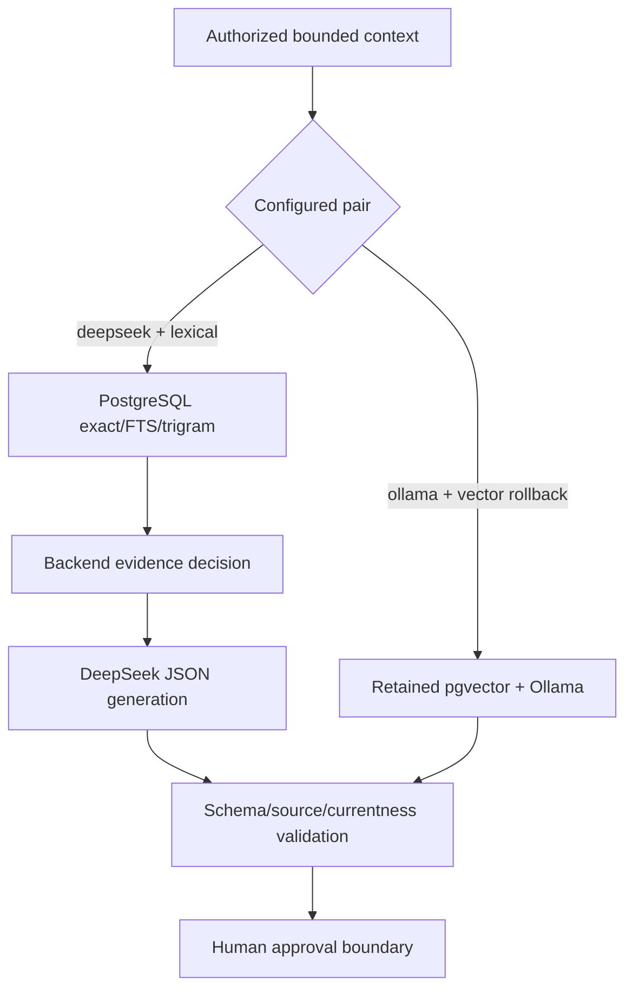
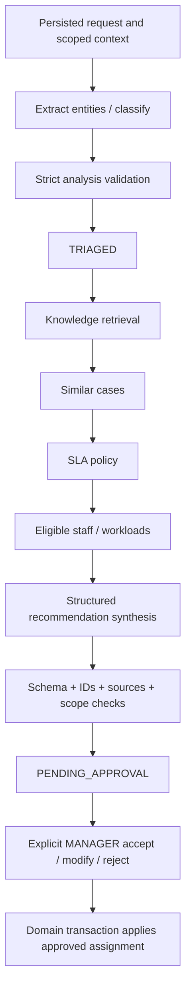

# AI Architecture

## V1.3 provider and retrieval routing (2026-10-23)

The active candidate uses one `DeepSeekProvider` instance for analysis, recommendation, Copilot and summary. The provider normalizes official chat-completion responses to the existing generation contract, records bounded token/cost identity, rejects incomplete JSON and never exposes reasoning. `KnowledgeRetriever` selects `LexicalRepository` in lexical mode; ingestion and request-similarity paths also bypass embeddings. `ollama` generation and pgvector retrieval remain a coupled, explicit rollback mode only. Provider selection cannot be supplied by browser/model input and never falls back silently.



Authority: master-plan §4, M4–M9, §§23–27. Controlled orchestration uses local providers behind stable interfaces; business authority remains in NestJS services. See [AI behavior](../specs/AI_BEHAVIOR_SPEC.md), [tools](../specs/TOOL_CALLING_SPEC.md), [RAG](../specs/RAG_SPEC.md) and [safety](../specs/AI_SAFETY_SPEC.md) for normative detail.

## Provider ports

Future interfaces equivalent to the master contract:

```ts
interface LlmProvider {
  healthCheck(): Promise<ProviderHealth>;
  generateText(input: GenerateTextInput): Promise<GenerateTextResult>;
  generateStructured<T>(input: StructuredInput<T>): Promise<StructuredResult<T>>;
}
interface EmbeddingProvider {
  embedText(text: string): Promise<number[]>;
  embedBatch(texts: string[]): Promise<number[][]>;
}
```

V1 adapters are OllamaLlmProvider and OllamaEmbeddingProvider. Provider input carries fixed prompt/template, bounded context, schema and AbortSignal/deadline; output carries text/typed candidate, actual provider/model metadata, latency and typed failure. Application validates even if the provider claims schema compliance. Generics are not runtime validation. Health distinguishes server reachability from each installed model; model names are configurable and cannot be inferred from examples. Reasoning fields are discarded, not included in GenerateTextResult logs.

Embedding output must be finite, nonzero and compatible with the active index identity/dimension. M5's actual probe determines vector schema D. Future Gemini/DeepSeek/OpenAI adapters are extension points only; no automatic cloud fallback or credentials in V1 runtime.

## Bounded data flow



Backend controls stage order and tool budgets. A fixed classifier may extract/classify together; no model-controlled open-ended action loop. Tools are registered read functions with typed I/O, purpose, scope, bounds, timeout, audit and failure. Recommendation and Copilot use distinct capability sets; an owner-triggered intake is not a permission to return organization-wide evidence to the owner.

## Publication and human control

Intake saves AiRun/AiAnalysis and processing-state transitions only. Recommendation saves validated immutable suggestion/evidence and pending review only. Manager transaction revalidates source generations, policy, eligible staff, request version and review identity before applying actual fields. Modify preserves original plus changes/final decision; reject returns to TRIAGED. Manual triage follows the same human approval boundary with no AI-shaped fake artifacts.

Every generation consumes a versioned context. Late results after cancel/reassign/another decision cannot commit or leak through polling. Missing facts remain null and visible. No-source recommendation has empty procedural actions and insufficient-evidence label; manager accept is blocked. Human-authored manual/modified actions remain distinguishable from AI-sourced advice.

## Copilot, summary and deterministic computations

STAFF gets six fixed actions on assigned requests, each with allowlisted context/tools and typed result. Saving/checking a checklist is a separate human command. Resolution summary refers to persisted resolution/event IDs; backend calculates time and copies root-cause/resolution/verification fields. Summary failure cannot unresolve a request or block owner confirmation.

Candidate eligibility/ranking, similar-case counts/scores and SLA status are deterministic backend computations. AI explains available facts; it does not invent counts, staff members, policy minutes, events or machine-learning claims. Confidence remains model self-report until calibration is actually evaluated.

## Recovery, telemetry and evaluation

AiRun is the durable job/telemetry record; per-purpose active uniqueness, timeouts, bounded retry, leases and versioned publication prevent duplicate/stuck work. Failure mapping is explicit: intake → NEW/FAILED, recommendation stays TRIAGED, Copilot leaves state unchanged, summary leaves resolution intact. Polling surfaces safe status with current access checks.

Store prompt version, schema version, actual model identity, timing, attempt count, tool/retrieval references and safe failure metadata. Store concise reasonSummary; no hidden chain-of-thought or unsanitized raw prompts. Evidence snapshots preserve immutable source IDs/generations; disable/reindex removes live eligibility without falsifying historical provenance.

Deterministic schema/tool/permission tests are independent from actual Ollama evaluation. M4 live intake, M5 real RAG, M6 controlled recommendations, M8 bounded Copilot/summary, M9 measured evaluation and M10 adversarial/offline demo gates are all required. No model availability, accuracy, performance or source quality result is claimed in M0.
