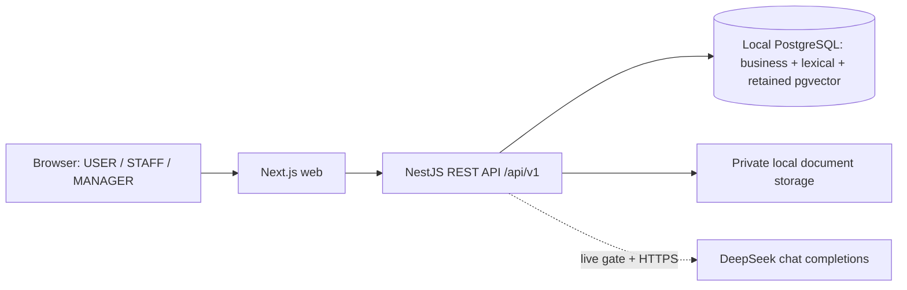
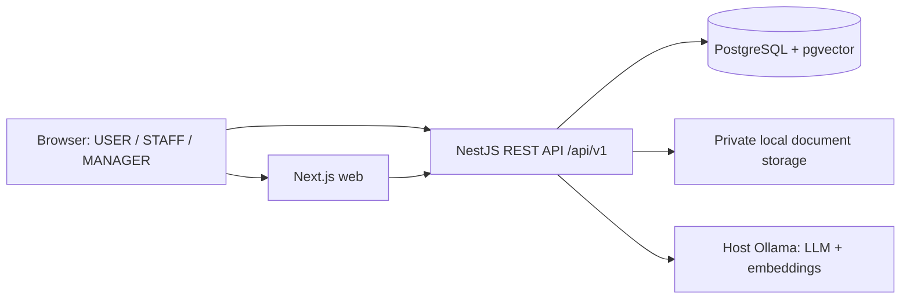

# Architecture

## V1.3 active candidate topology (2026-10-23)



The API routes every generation purpose through one configured DeepSeek adapter and every active knowledge/request-similarity lookup through PostgreSQL lexical repositories. Live egress is disabled by default. Core/manual/lexical operation has no Ollama dependency; health exposes database, retrieval, generation and disabled rollback components separately. `ollama` + `vector` remains an explicit operator-selected rollback pair with no automatic fallback. See [ADR 0006](adr/0006-deepseek-postgres-lexical.md). The historical V1 topology below is retained for lineage.

Authority: master-plan §§3, 5–10, M1–M10. Status: M0 design freeze; no services or dependencies have been created. Decisions are recorded in ADRs [0001](adr/0001-monorepo.md), [0002](adr/0002-postgres-pgvector.md), [0003](adr/0003-local-ollama.md), [0004](adr/0004-controlled-ai-orchestration.md), [0005](adr/0005-human-in-the-loop.md).

## Local deployment and trust boundaries



Default Docker Compose services will be postgres/api/web; persistent DB volume and private document volume. Ollama runs on Windows host. Container API uses `http://host.docker.internal:11434`; native API uses `http://localhost:11434`. Optional Dockerized Ollama is not required. No Redis, second vector store, cloud dependency, external event stream or Python service.

Planned local ports: web 3000, API 3001, DB optional localhost 5432, host Ollama 11434. Web/API bind to localhost for the demo; DB is private Compose networking with optional localhost-only development port. Host Ollama access must be reachable from Docker while restricted by host firewall to the necessary local path; do not expose it publicly. Verify actual host/Compose networking in M1, not assume it from this diagram. CORS allows exact web origin; the browser never accesses DB, document filesystem or Ollama directly.

M1 health distinguishes API, DATABASE, OLLAMA_SERVER, OLLAMA_LLM_MODEL, OLLAMA_EMBEDDING_MODEL and VECTOR_EXTENSION. Core ready depends on API/DB/vector, AI readiness is separate; Ollama offline leaves manual workflow available. Fully offline runtime requires preloaded models/images/packages/fonts/assets and prepared data; M10 tests this without Internet.

## Monorepo and module ownership

```text
apps/web                 Next.js App Router and role-specific UI
apps/api                 NestJS controllers, application/domain services, adapters
packages/contracts       Shared DTO/schema/enums; no server secrets or ORM internals
packages/config          Typed nonsecret shared configuration helpers
packages/eslint-config   Lint configuration
packages/tsconfig        Strict TypeScript baselines
docs                     Specs, ADRs, verification, later demo/evaluation artifacts
scripts/dev              Later development commands
scripts/demo             Later safe seed/reset/preflight/warmup
scripts/evaluation       Later live AI/RAG runner
scripts/verification     M0 dependency-free documentation verification
datasets/ai-evaluation   Later independently labeled synthetic data
docker                   Later Docker build/configuration assets
```

NestJS modules: auth/users; teams/skills; requests/messages; state machine; assignments; approval; checklist/resolution/feedback; knowledge/ingestion/vector repository; AI providers/orchestration/tools; SLA; notifications; audit; analytics; health. This is one API deployable, not microservices.

Controllers handle transport validation and delegate. Application services coordinate transactions. Domain services enforce state, ownership, eligibility and clock rules. Repositories encapsulate Prisma/parameterized SQL. DTOs/projections prevent exposing persistence/private AI fields. RequestStateMachineService exclusively writes status after creation; no UI or model can directly mutate it.

## Transactions, work and recovery

Use optimistic request versions plus transactional conditional writes/locks. An approval transaction applies human decision, final request values, assignment, checklist, SLA, status history, notifications and audit together. Audit failure aborts critical business changes. No external AI/PDF call is held inside a DB transaction. Notifications are durable in-app rows and require no delivery integration.

Use AiRun rows as a small durable bounded work list for generation and KnowledgeDocument processing metadata for ingestion. The API's internal worker polls eligible QUEUED jobs, atomically claims leases, enforces concurrency/deadlines and validates active scope/version at commit. At startup and periodic recovery, expired RUNNING/PROCESSING work becomes a recorded failure with a safe retry action; never leave a request AI_ANALYZING indefinitely. No uncontrolled repeated scheduling. SLA scheduler computes from stored times, so missed ticks are recoverable. Exact bounds live in AI_BEHAVIOR_SPEC and RAG_SPEC.

Manual triage and human state actions do not depend on LLM/embedding availability. AI recommendations are immutable advisory records until manager accept/modify; source disable, reindex or staff eligibility change can block a stale approval. Resolution summary is post-commit derived data, never a prerequisite for owner confirmation.

## Environment and configuration

M1 validates DATABASE_URL, JWT_SECRET, REFRESH_TOKEN_SECRET, OLLAMA_BASE_URL, OLLAMA_MODEL, OLLAMA_EMBEDDING_MODEL and AI_PROVIDER=ollama; adds explicit allowed web origin/storage/demo flags/bounds as documented. Secrets are API-only; public web config contains only safe API origin. `.env.example` in M1 uses descriptive placeholders, never active credentials or an unverified model tag.

Model tags/digests/dimension and Node/npm/framework/Prisma/Postgres/pgvector versions are selected after local verification and pinned in manifests/lockfile/container definitions at their owning milestone. M0 does not assert current package compatibility. Separate migration and runtime DB privileges; database secrets never reach browser/LLM. Production cloud deployment is a non-goal.

## Observability and audit

Structured API logs: request ID, route template, method, status, latency and authenticated actor ID; no passwords/tokens/full request bodies by default. AI metadata: actual provider/model, purpose, prompt/schema version, timing, attempts, validity, retrieval count/tool names and safe error code. Domain audit distinguishes USER/STAFF/MANAGER/AI/SYSTEM; original human initiator and internal executor remain traceable. Request timeline uses safe business events; manager-only audit may expose additional safe decision diffs.

## Failure boundaries and acceptance

DB unavailable: readiness fails and writes fail safely. Ollama absent/model missing: core API lives, truthful aiReady=false, persisted request/manual workflow survive. Invalid model output: fail bounded run; no sensitive state mutation. Worker crash: recovery lease produces retryable failure. Document index failure: FAILED, no partial READY. Concurrent approval: one commit, one conflict.

M1 proves boot/build/connectivity/health; M2 schema/auth; M3 transactions/manual lifecycle; M4–M8 AI/knowledge/human boundaries; M9 measurements; M10 actual Docker/native/offline/security/demo readiness. [IMPLEMENTATION_PLAN](../IMPLEMENTATION_PLAN.md) owns sequencing. M0 architecture acceptance is internal consistency and explicit contracts, not runtime verification.
